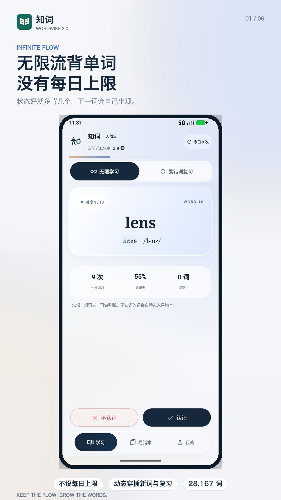
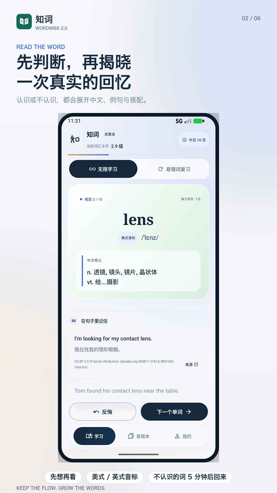
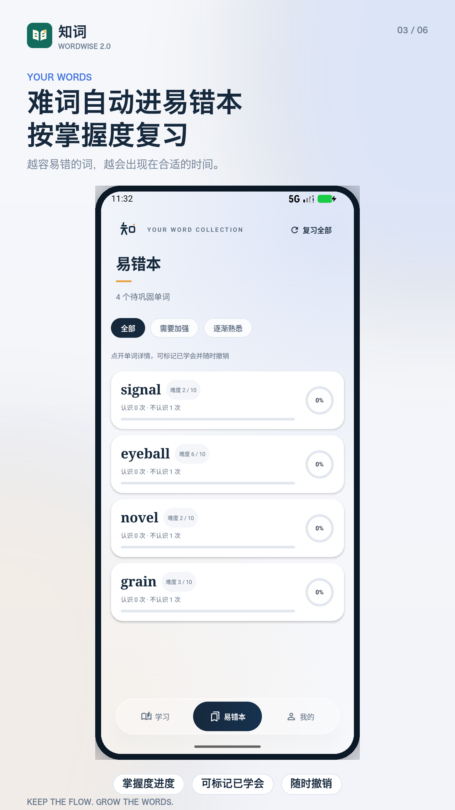

<div align="center">
  
  <h1>知词 · Wordwise</h1>
  <p><strong>每天多认识一点世界。</strong></p>
  <p>一款完全离线的 Android 英语词汇学习应用，以连续学习、自适应复习和语境理解为核心。</p>
  <p>Android 8.0+ · Kotlin · Jetpack Compose · Room · 28,167 词</p>
</div>


## 为什么做知词

打开就能开始，学完一个词自然进入下一个。知词不设置每日词数上限，也没有账号、广告或签到任务。你可以用几分钟认识几个新词，也可以在状态好的时候持续学习；应用根据本机作答记录安排复习，帮助你把注意力放回单词本身。

当前应用版本 **2.0.11**，词库内容版本 **20**。本次更新整理项目目录、重做扁平化品牌图标并完善发布与构建说明，词库和学习调度逻辑保持原有数据与行为。

## 功能

| 功能 | 使用体验 |
| --- | --- |
| 连续学习 | 不设每日上限；先判断认识程度，再展开释义和词汇资料 |
| 自适应学习流 | 根据近期新词表现与待复习积压，动态穿插新词和复习；常态复习概率为 40%，可调整为 30% 或 60% |
| 起点校准 | 首次通过 20 个词校准起点，之后依据真实学习表现持续调整内部等级 |
| 间隔回顾 | 不认识的词最早 5 分钟后重新进入复习，调度同时考虑错误与逾期情况 |
| 易错词管理 | 按掌握情况查看易错词，支持标记已学会、撤销和继续复习 |
| 词汇详情 | 美式 / 英式音标、中文释义、例句、搭配、词形、派生、同义及易混辨析；缺项如实留空 |
| 本地统计 | 保存学习记录、学习用时、连续学习天数与个人水平 |
| 交互设置 | 支持口音选择、声音与触感反馈设置 |
| 离线隐私 | 无需登录；不申请网络权限；学习记录存于本机，无广告或分析 SDK |

内部 1—10 级用于安排学习顺序，**不等同于 CEFR、考试分数或标准化语言能力认证**。

## 词库实际覆盖

以下数字取自当前随包词库及来源清单；“覆盖”指至少收录一项，不代表逐条人工审核。

| 内容 | 覆盖词数 |
| --- | ---: |
| 总词数 | 28,167 |
| 至少一个例句 | 23,469 |
| 至少一条双语例句 | 21,381 |
| 英式音标 | 27,071 |
| 搭配 | 10,268 |
| 派生与词族 | 14,461 |
| 词形变化 | 16,712 |
| 同义关联 | 15,829 |

全库仍有 **4,698 个词缺例句**、**3,029 条例句缺中文**。部分公开学习内容来自基于维基词典的模型扩写数据，词条保留来源与生成性质说明。数据空缺与阶段验证见 [词库与验证记录](docs/validation/VALIDATION-v2.0.10.md)。

## 界面预览

现有功能截图采集于此前版本，画面中的应用内图标可能仍为旧版；本次图标以顶部品牌图为准。

<p>



</p>

## 下载安装

在 [GitHub Releases](https://github.com/luodehua321/wordwise-android/releases) 下载 arm64-v8a APK，适用于 Android 8.0 及以上。覆盖更新需使用相同签名；本项目本地交付包延续原证书。

本次项目整理与构建检查见 [2.0.11 验证记录](docs/validation/VALIDATION-v2.0.11.md)。

## 构建与运行

需要 **JDK 17 或兼容版本**、Android SDK Platform 35、Build Tools 36.0.0 和 Python 3.9+。Gradle Wrapper 为 8.9，Java/Kotlin 字节码目标为 17。界面采用 Jetpack Compose，最低 Android 8.0（API 26），当前仅打包 arm64-v8a。

1. 用 Android Studio 打开项目，配置 Android SDK，或在本机创建 `local.properties`：

   ```properties
   sdk.dir=/your/path/to/Android/sdk
   ```

2. 构建调试包并运行现有单元测试：

   ```sh
   ./gradlew :app:testDebugUnitTest :app:assembleDebug
   ```

3. 生成启用 R8 和资源压缩的构建：

   ```sh
   ./gradlew :app:assembleRelease
   ```

首次构建会自动用 `tools/prepare_vocabulary.py` 从已提交的词库 JSON 和 Room schema 生成 SQLite 与二进制缓存；此步骤无需网络、仅使用 Python 标准库。首次下载 Gradle 和 Android 依赖仍需要网络。可用 `-PpythonExecutable=/absolute/path/to/python3` 指定 Python。

APK 位于 `app/build/outputs/apk/`。本地整理后的安装包位于被 Git 忽略的 `dist/`。

**签名与覆盖安装：** 原安装证书必须保存在本机 `keystore/wordwise-debug.keystore`，不会提交到 GitHub。新克隆在没有此文件时使用该机器的 Android 默认调试证书，因此不能直接覆盖原证书签名的安装；正式分发应自行配置私有发布签名。当前 Release 构建延续历史调试证书策略，Release 表示优化构建类型。

## 词库维护和验证

`app/src/main/assets/vocabulary.json` 是当前权威词库。单词 ID 与学习记录关联，请勿随意改动。修改后重建缓存，并校验数据一致性：

```sh
python3 tools/prepare_vocabulary.py
python3 tools/prepare_vocabulary.py --check
python3 tools/check_prepared_binary.py
python3 tools/test_vocabulary.py
```

现有 Android 回归测试位于 `app/src/androidTest/`，有可用设备或模拟器时运行 `./gradlew :app:connectedDebugAndroidTest`。详细数据工具说明见 [tools/README.md](tools/README.md)，历史性能结果见 [性能报告](docs/validation/PERFORMANCE-v2.0.10.md)。

## 项目结构

```text
app/
  src/main/java/…/       Compose 界面、学习调度、本地数据库与反馈
  src/main/assets/       词库、来源、署名和许可证
  src/main/res/          Android 图标与界面资源
  src/test/              JVM 单元测试
  src/androidTest/       设备回归与性能测试
  schemas/               Room 数据库迁移 schema
  build.gradle.kts       构建、签名回退和词库预处理
docs/
  brand/                 Logo SVG、PNG、设计说明和预览
  validation/            当前基线验证与性能报告
  history/               历史文档归档
store/                   商店文案、隐私政策草稿与界面素材
tools/                   词库处理、审计、设计与截图工具
```

## Logo

新标志以翻开的书页表达知识，以中央留白表达连续阅读，以琥珀色书签表达“记住一个词”。叶绿 `#126B5D`、米白 `#FFF9EC`、琥珀 `#F4BB54` 三种纯色构成全部视觉，无渐变或阴影。提供 SVG、PNG、Android 自适应及单色主题图标，详见 [品牌说明](docs/brand/README.md)。

## 数据来源与许可

词库汇集 ECDICT、ipa-dict、WordNet / Open English WordNet、Tatoeba / ManyThings、NGSL、中文维基词典与 Open Dictionary 等公开来源，并包含项目原创修订。不同部分分别适用 MIT、BSD、WordNet 条款、CC BY、CC BY-SA、GPL 等许可；**不能把整套词库统一视为 MIT**。

- [完整来源与哈希清单](app/src/main/assets/dictionary_sources.json)
- [随包许可证及署名](app/src/main/assets/dictionary_licenses.txt)
- [英国音标独立来源和 GPL 说明](app/src/main/assets/british_ipa/SOURCE-NOTICE.txt)
- [隐私政策草稿](store/privacy-policy.md)

应用代码目前未指定统一开源许可证；公开仓库供查看，额外使用权需由项目所有者另行授权。数据和字体等第三方内容始终按各自许可证处理。
