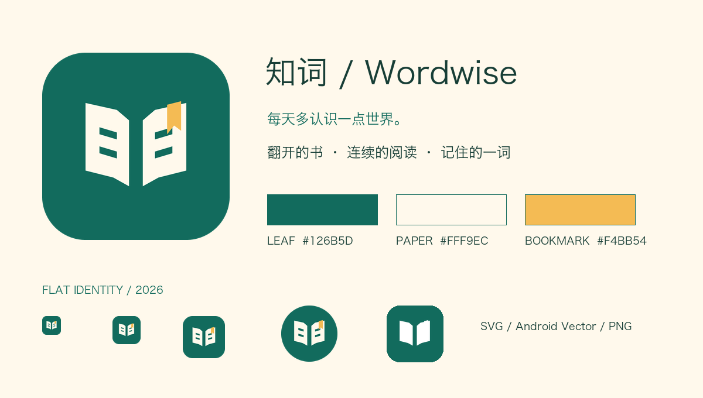

# 知词 · Wordwise 品牌标识



新版标识采用扁平几何构图：两页展开的书是知识入口，中间的留白维持清晰结构，阅读线暗示文字，右上琥珀书签代表刚记住的一个词。书页下缘向中央收拢，形成连续向前阅读的视觉动势。图案不依赖字体，适用于小尺寸启动图标。

| 角色 | 颜色 | 用途 |
| --- | --- | --- |
| 叶绿 | `#126B5D` | 背景、独立标志、阅读线 |
| 米白 | `#FFF9EC` | 书页、浅色背景 |
| 琥珀 | `#F4BB54` | 书签与唯一强调色 |

- `wordwise-icon.svg`：108 × 108 可缩放图标。
- `wordwise-mark.svg`：透明背景独立标志。
- `wordwise-icon.png`：512 × 512 图标。
- `wordwise-mark.png`：256 × 256 透明标志。
- `preview.png`：配色、小尺寸、圆形和主题图标展示。
- `../../store/icon-512.png`：商店用全出血纯色底图。

安卓图标由 `tools/generate_app_icon.py` 同一组几何坐标生成；前景缩至 72%，全部顶点落在 66dp 安全圆内。支持 API 26+ 自适应蒙版和 API 33+ 单色主题。单色版去掉阅读线，保留两页书的轮廓，避免复杂细节。

重建方式：

```sh
python3 -m pip install -r tools/requirements-design.txt
python3 tools/generate_app_icon.py
```

Logo 源图不依赖字体。预览板在 macOS 使用系统冬青黑体；其他系统回退英文文案与 Pillow 默认字体。
